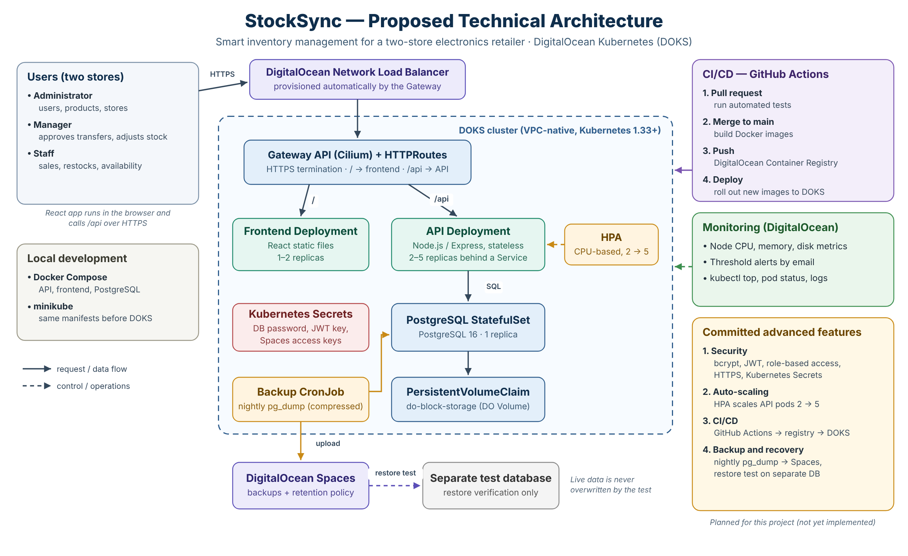

# StockSync: Smart Inventory Management for a Two-Store Electronics Retailer

**Live application:** https://stocksync.online
**Repository:** https://github.com/sohaib629/ccproject
**Video demo:** _link to be added (see [Section 12](#12-video-demo))_


ECE1779: Introduction to Cloud Computing, Fall 2026, final project report.

---

## 1. Team Information

| Name | Student number | Email |
|---|---|---|
| Sohaib Anwar | 1013959619 | _email_ |
| Rayyan Zaman | 1007647986 | _email_ |
| Yiheyis Debru Ameha | 1010796925 | _email_ |

---

## 2. Motivation

Small electronics retailers with more than one store often track inventory in
spreadsheets, group chats or disconnected records. Staff then cannot tell whether
an item is really available at their location, already sold, or on its way from
the other store. This is especially costly for high-value, theft-prone products
such as laptops, phones and game consoles.

StockSync targets three concrete problems:

- **Overselling.** Two staff members sell the last unit at the same moment and both
  sales succeed, because each one read "1 in stock" before the other wrote.
- **Untracked transfers.** Stock leaves one store but is never confirmed at the
  other, so units disappear between locations.
- **No accountability.** Quantities change without a record of who changed them,
  when, and why.

Spreadsheets are cheap but cannot coordinate concurrent changes, while full retail
suites are more than a two-store operator needs or can afford. A shared system with
transactional stock updates and an append-only audit history removes these
discrepancies.

It is also a meaningful cloud-computing problem. Inventory is **persistent state
accessed concurrently by many users through many API replicas**, so the project is a
focused setting for orchestration, persistent storage, scaling, security and
recovery, not just a page that lists products.

---

## 3. Objectives

The project builds a web application for one fictional retailer with two stores
(Downtown and North York, Toronto) and deploys it as a stateful cloud-native system.

**Functional objectives**

1. Three roles (**Administrator, Manager, Staff**) with every permission enforced on
   the server.
2. A product catalogue with SKUs, categories, prices and reorder thresholds.
3. Per-store stock that **can never become negative**, even under concurrent sales.
4. Sales, restocks and manager adjustments.
5. Transfers between stores through **Requested → In Transit → Received**, received
   exactly once, with cancellation that returns in-transit units.
6. An **append-only audit history** of every change: action, quantity, product,
   store, user and time.
7. A low-stock view of items at or below their reorder threshold.

**Cloud objectives**

1. A reproducible local environment with Docker Compose.
2. The same application on Kubernetes, locally on minikube and in the cloud on
   DigitalOcean Kubernetes (DOKS), using one set of base manifests.
3. Self-managed PostgreSQL with persistent storage (StatefulSet + PVC on
   DigitalOcean Volumes).
4. HTTPS on a real domain, monitoring with alerts, and four advanced features:
   security, auto-scaling and high availability, CI/CD, and backup and recovery.
5. Correctness that holds **no matter which API replica handles a request**, proven
   by tests rather than assumed.

Suppliers, purchasing, payments, point-of-sale integration and forecasting are out
of scope; the seeded inventory (12 products across two stores) is synthetic.

---

## 4. Technical Stack

| Layer | Technology | Why |
|---|---|---|
| Frontend | **React 19** + Vite 8, served by `nginx-unprivileged` (non-root, port 8080) | Simple single-page app; one build works everywhere because it calls the relative path `/api` |
| Backend | **Node.js 24, Express 5**, `pg` (raw SQL), zod validation, bcryptjs, jsonwebtoken, helmet, express-rate-limit, pino logging | Stateless REST API; raw SQL keeps transaction behaviour explicit |
| Database | **PostgreSQL 18** | Constraints, triggers, row locks and transactions provide the consistency guarantees |
| Containers | **Docker**, multi-stage images built for `linux/amd64` | Same images run on a Mac (M3) and in the cloud |
| Local orchestration | **Docker Compose** with Docker secrets, healthchecks and a named volume | One command starts the full stack |
| Kubernetes | **minikube** locally, **DOKS** (Kubernetes 1.37) in the cloud, **Kustomize** base + overlays | One set of manifests for every environment |
| Ingress | **DOKS managed Gateway API** (Cilium) → DigitalOcean Network Load Balancer | Replaces the retired community Ingress NGINX controller |
| TLS | **cert-manager** v1.21 + **Let's Encrypt** (HTTP-01 through the Gateway) | Certificate lifecycle declared in git and renewed automatically |
| Cloud | **DigitalOcean**: DOKS, Container Registry (DOCR), Volumes, DNS, Monitoring, Spaces | One provider for compute, storage, images, DNS and alerts |
| CI/CD | **GitHub Actions** with required status checks and branch protection on `main` | Every change is tested before it can be merged |
| Testing | `node:test` integration suite (42 tests), shell smoke test, concurrency race script, k6 load test | Tests prove correctness, not just that endpoints respond |

### Architecture



```
Browser ──HTTPS──► stocksync.online (DigitalOcean DNS)
                   │
                   ▼
        DigitalOcean Network Load Balancer (created by the Gateway)
                   │  TCP pass-through
                   ▼
        Gateway "stocksync" (DOKS managed Gateway API)
          :80   ACME challenge, otherwise 301 → https
          :443  TLS with the Let's Encrypt certificate
                   │
         ┌─────────┴──────────┐
     /api/*                  /*
  Service api:3000     Service frontend:8080
  (2–5 pods, HPA)      (2 nginx pods)
         │
  Service postgres (headless) → StatefulSet postgres-0
                                 └── PVC → DigitalOcean Volume (do-block-storage)
```

The API is **stateless**: all persistent data lives in PostgreSQL. Any API replica
can serve any request, and correctness comes from database transactions rather than
in-memory locks.

### Data model

| Table | Purpose | Integrity rules |
|---|---|---|
| `stores` | the two locations | unique store code |
| `users` | accounts with role and home store | role ∈ {admin, manager, staff}; non-admins must belong to a store |
| `products` | SKU, name, category, price, reorder threshold | unique SKU, price ≥ 0 |
| `stock` | quantity of each product at each store | unique `(store_id, product_id)`, `CHECK (quantity >= 0)` |
| `transfers` | inter-store movements and their status | different source and destination, valid status transitions |
| `stock_movements` | audit history of every quantity change | **append-only**: a trigger rejects `UPDATE` and `DELETE` |

---

## 5. Features

### 5.1 Core inventory features

- **Sales.** One atomic conditional update:
  `UPDATE stock SET quantity = quantity - $n WHERE … AND quantity >= $n`.
  If no row is updated, the sale fails with `409 OUT_OF_STOCK`. The stock change and
  its audit row commit in the **same transaction**, so one cannot exist without the
  other.
- **Restocks and adjustments.** Staff restock their own store; managers can adjust
  stock up or down with a mandatory reason (for example, damage or a recount).
- **Transfers.** Request → **Dispatch** (only the source-store manager; stock leaves
  the source) → **Receive** (only the destination store; stock arrives exactly once)
  or **Cancel** (in-transit units return to the source). Each step locks the
  transfer row with `SELECT … FOR UPDATE`, so concurrent dispatch, receive or cancel
  requests are serialized and only the first valid transition wins.
- **Audit history.** Every change writes a `stock_movements` row (`sale`, `restock`,
  `adjustment`, `transfer_out`, `transfer_in`, `transfer_return`) with user, store,
  quantity, note and timestamp. The table is append-only, enforced by a database
  trigger, not just by the application.
- **Low-stock view.** Items at or below their reorder threshold, per store.
- **System page (admin).** A live view of the infrastructure: which API replica
  answered, the replicas seen recently, the Kubernetes pod, node and namespace (via
  the Downward API), PostgreSQL version, latency, size and connection pool, live
  integrity checks, authentication settings (never secret values), the permissions
  matrix and the route list.

### 5.2 Advanced feature 1: Security

- Passwords hashed with **bcrypt** (cost 12); login returns a **JWT** (HS256,
  8-hour expiry).
- **Role-based authorization on every API endpoint**, plus **store scoping**: staff
  and managers can act only on their own store. Hiding buttons in the UI is only a
  convenience; the API enforces every rule (tested with 401/403 cases).
- **Login rate limiting**: 10 failed attempts per 15 minutes; successful logins are
  not counted.
- **helmet** security headers on the API and a strict **Content-Security-Policy**
  from nginx (`default-src 'self'`, `frame-ancestors 'none'`).
- **HTTPS everywhere** with a Let's Encrypt certificate and an HTTP → HTTPS
  redirect at the Gateway.
- **Secrets are never in git.** Locally they are Docker secrets mounted as files;
  on Kubernetes they are a Secret created by `k8s/bootstrap.sh` and mounted at
  `/run/secrets` with mode `0440`. The database pod receives only the database
  password, not the JWT key.
- **Hardened pods**: non-root, all Linux capabilities dropped, no privilege
  escalation, default seccomp profile, read-only root filesystem for the API, and
  `automountServiceAccountToken: false` (no pod needs the Kubernetes API).
- **Ports bound to localhost** in Docker Compose (API `127.0.0.1:3000`, DB
  `127.0.0.1:5433`) so the database is never exposed on the network.

### 5.3 Advanced feature 2: Auto-scaling and high availability

- **Two API replicas and two frontend replicas** at all times, spread across both
  nodes with `topologySpreadConstraints`, and a **PodDisruptionBudget** so node
  maintenance never takes all API pods down.
- **Rolling updates** with `maxSurge: 1, maxUnavailable: 0` and a `preStop` delay,
  so deployments cause no downtime.
- **Probes split by purpose**: readiness (`/ready`) checks the database, liveness
  (`/health`) checks only the process. If PostgreSQL goes down, API pods stop
  receiving traffic but are not restarted in a loop.
- **Horizontal Pod Autoscaler**: scales the API from 2 to 5 replicas on CPU
  utilization (requests `100m` CPU), demonstrated with a sustained k6 load test.
  _(Day 6: add the `kubectl get hpa -w` results and screenshots here.)_

### 5.4 Advanced feature 3: CI/CD

- **CI** (`.github/workflows/ci.yml`) runs on every pull request and every push to
  `main`, with four **required** checks:
  1. **Backend tests (PostgreSQL 18)**: the full 42-test suite against a fresh
     PostgreSQL service container.
  2. **Frontend build**.
  3. **Docker images build** for `linux/amd64`.
  4. **Kubernetes manifests**: both overlays rendered with Kustomize and validated
     with kubeconform, including the Gateway API and cert-manager CRDs.
- **Branch protection** on `main`: no direct pushes (also for the admin), branches
  must be up to date, and all four checks must pass before merging.
- **CD**: merges to `main` build both images, push them to DigitalOcean Container
  Registry tagged with the git commit, and deploy them to DOKS with
  `k8s/deploy.sh`, which pins the image tags and waits for every rollout.
  _(Day 6: add the pipeline run and deployment evidence here.)_

### 5.5 Advanced feature 4: Backup and recovery

- A nightly Kubernetes **CronJob** runs `pg_dump`, compresses the dump and uploads it
  to **DigitalOcean Spaces**, keeping the last 7 backups, with credentials scoped to
  one bucket.
- **Restore test**: a backup is restored into a separate database and its record
  counts and sample rows are compared with the source, without touching live data.
  _(Day 6: add the backup listing and restore comparison here.)_

### 5.6 Monitoring

- DigitalOcean **resource alerts** on every worker node (CPU > 80%, memory > 85%,
  disk > 80% for 5 minutes), attached by the cluster tag so new nodes are covered
  automatically.
- An external **uptime check** of `https://stocksync.online/api/health` from three
  regions. This one check covers DNS, TLS, load balancer, Gateway, API and database.
  It alerts when the site is down and when the TLS certificate expires within 14
  days.
- `kubectl top`, pod status, structured JSON logs (pino) and the admin System page.
- Everything is created by `monitoring/setup-alerts.sh`.

---

## 6. User Guide

Open **https://stocksync.online** and sign in with one of the demo accounts below.
The demo password is shared with the teaching team separately.

| Email | Role | Store |
|---|---|---|
| admin@stocksync.dev | Administrator | all stores |
| manager.dt@stocksync.dev | Manager | Downtown |
| staff.dt@stocksync.dev | Staff | Downtown |
| manager.ny@stocksync.dev | Manager | North York |
| staff.ny@stocksync.dev | Staff | North York |

### 6.1 Sign in
_Screenshot: `docs/screenshots/login.png`_

### 6.2 Inventory
Both stores side by side, with low and out-of-stock items highlighted. Filter by
category or search. **Sell** and **Restock** are available for your own store;
managers also see **Adjust** (requires a reason). Selling more than is in stock is
refused with an "out of stock" message.
_Screenshot: `docs/screenshots/inventory.png`_

### 6.3 Transfers
1. Any user of either store **requests** a transfer (product, from, to, quantity).
2. The **source-store manager dispatches** it: the units leave the source store and
   the transfer is *In Transit*.
3. The **destination store receives** it: the units arrive, exactly once.
4. A manager of either store can **cancel**; in-transit units return to the source.

_Screenshot: `docs/screenshots/transfers.png`_

### 6.4 Low stock
Items at or below their reorder threshold, per store.
_Screenshot: `docs/screenshots/low-stock.png`_

### 6.5 History
The audit log, newest first, filterable by product, type and user, with paging.
Managers and staff see their own store; the administrator sees both.
_Screenshot: `docs/screenshots/history.png`_

### 6.6 System (administrator only)
Live infrastructure status. Refresh it to see requests answered by different API
replicas.
_Screenshot: `docs/screenshots/system.png`_

### 6.7 What each role can do

| Action | Staff | Manager | Admin |
|---|---|---|---|
| View inventory, low stock | ✓ | ✓ | ✓ |
| Sell, restock (own store) | ✓ | ✓ | ✓ (any) |
| Adjust stock | | ✓ (own store) | ✓ |
| Request transfer | ✓ | ✓ | ✓ |
| Dispatch transfer | | source manager | ✓ |
| Receive transfer | destination store | destination store | ✓ |
| Cancel transfer | | either store's manager | ✓ |
| View history | own store | own store | all |
| System page, user list | | | ✓ |

---

## 7. Development Guide

### 7.1 Prerequisites
Docker Desktop, Node.js 24 (`nvm use` reads `.nvmrc`), git. For Kubernetes:
`kubectl` and minikube.

### 7.2 Run locally with Docker Compose

```bash
git clone https://github.com/sohaib629/ccproject.git && cd ccproject

# One-time: create local secrets (git-ignored)
openssl rand -hex 24 > secrets/db_password.txt
openssl rand -hex 32 > secrets/jwt_secret.txt
cp .env.example .env          # set WEB_HOST_PORT if 8080 is taken

docker compose up --build -d
docker compose ps             # db, api and frontend all "healthy"
open http://localhost:8080    # or http://localhost:$WEB_HOST_PORT
```

The database schema and seed data in `database/init/` load automatically on first
start into the named volume. `docker compose down -v` resets everything.

### 7.3 Tests

| What | Command |
|---|---|
| Integration suite (42 tests, separate `stocksync_test` database) | `cd backend && npm ci && npm test` |
| Smoke test (13 checks: health, login, roles, headers) | `./tests/smoke-day1.sh` |
| Last-unit race (20 buyers, 1 unit) | `node tests/concurrency-test.mjs` |
| Database integrity checks | `docker compose exec -T db psql -U stocksync -d stocksync < database/checks.sql` |

The smoke and race scripts accept `API_URL=…` to target minikube or the live site.
The test harness refuses to run against any database whose name does not end in
`_test`, so development data is never touched. See [docs/testing.md](docs/testing.md).

### 7.4 Frontend with hot reload

```bash
docker compose up -d db api
cd frontend && npm ci && npm run dev     # http://localhost:5173, /api proxied to :3000
```

### 7.5 Kubernetes on minikube

```bash
minikube start -p stocksync --driver=docker --cpus=4 --memory=6g
minikube -p stocksync addons enable metrics-server
docker compose build
minikube -p stocksync image load stocksync-api:dev
minikube -p stocksync image load stocksync-frontend:dev
./k8s/bootstrap.sh                          # Secret + init-SQL ConfigMap
kubectl apply -k k8s/overlays/minikube
kubectl -n stocksync rollout status deploy/api
kubectl -n stocksync port-forward svc/frontend 7080:8080   # http://localhost:7080
```

See [docs/kubernetes.md](docs/kubernetes.md) for the design and the persistence,
self-healing, rolling-update and database-outage tests.

### 7.6 Repository layout

```
backend/     Express API, Dockerfile, test suite
database/    init/ schema + seed, checks.sql integrity checks
frontend/    React app (Vite) and its nginx Dockerfile
k8s/         base + minikube/doks overlays, cluster/ issuers, bootstrap.sh, deploy.sh
monitoring/  DigitalOcean alerts and uptime check
tests/       smoke, concurrency and load tests
docs/        kubernetes, deployment and testing details
.github/     CI workflow
```

### 7.7 API reference

All `/api` routes except login and health require `Authorization: Bearer <token>`.
Errors are returned as `{ "error": { "code", "message", "details" } }`.

| Method | Path | Access | Purpose |
|---|---|---|---|
| GET | /health, /ready | public | liveness / readiness probes |
| GET | /api/health | public | end-to-end health through the Gateway |
| POST | /api/auth/login | public, rate-limited | email + password → JWT |
| GET | /api/auth/me | any role | current user |
| GET | /api/stores | any role | list stores |
| GET | /api/users | admin | list accounts |
| GET | /api/products, /api/products/:id | any role | catalogue with per-store quantities |
| GET | /api/stock, /api/low-stock | any role | stock rows, low-stock list |
| POST | /api/sales | own store | sell; 409 `OUT_OF_STOCK` if not enough |
| POST | /api/restocks | own store | add stock |
| POST | /api/adjustments | manager/admin, own store | signed change with reason |
| GET/POST | /api/transfers, /api/transfers/:id | involved stores, admin | list, view, request |
| POST | /api/transfers/:id/dispatch \| receive \| cancel | see role table | transfer lifecycle |
| GET | /api/movements | own store (admin all) | audit history with filters and paging |
| GET | /api/system | admin | infrastructure status (no secret values) |

---

## 8. Deployment

### 8.1 Live URL
**https://stocksync.online**: DOKS cluster `stocksync`, region `nyc3`, Kubernetes
1.37, 2 × `s-2vcpu-4gb` nodes.

### 8.2 Cloud architecture

| Component | DigitalOcean resource |
|---|---|
| Cluster | DOKS, **VPC-native** (required for the managed Gateway API) |
| Images | Container Registry, images tagged with the git commit, built for `linux/amd64`, pulled with a registry Secret generated by `doctl` |
| Ingress | Gateway API (`gatewayClassName: cilium`) → automatically provisioned Network Load Balancer |
| TLS | cert-manager + Let's Encrypt `ClusterIssuer` (staging and production), HTTP-01 solved through the Gateway, ECDSA key, automatic renewal |
| Routing | HTTPRoute `/api` → `api:3000`, `/` → `frontend:8080`; separate HTTPRoute for 301 HTTP → HTTPS |
| Storage | StatefulSet `postgres` with PVC → DigitalOcean Volume (`do-block-storage`) |
| DNS | DigitalOcean DNS (nameservers delegated from the registrar) |
| Monitoring | Node resource alerts by cluster tag, uptime check with down and TLS-expiry alerts |
| Backups | Spaces bucket for nightly `pg_dump` files |

The **same base manifests** run on minikube and DOKS. The `doks` overlay only adds
the Gateway, routes, Certificate, registry pull Secret and `DEPLOY_ENV=doks`.

### 8.3 Deployment instructions

```bash
# 0. Tools: doctl (authenticated), kubectl, docker buildx
# 1. Create a VPC-native DOKS cluster (doctl ... --cluster-subnet ... --service-subnet ...),
#    2 x s-2vcpu-4gb nodes, and save its kubeconfig
doctl kubernetes cluster kubeconfig save stocksync

# 2. Install cert-manager v1.21 with Gateway API support (--enable-gateway-api),
#    then the Let's Encrypt issuers
kubectl apply -f k8s/cluster/cluster-issuers.yaml

# 3. Registry, Secret, init SQL and registry pull Secret
export DOCR_REGISTRY=registry.digitalocean.com/<registry>
./k8s/bootstrap.sh doks

# 4. Build, push and deploy images pinned to the current commit
./k8s/deploy.sh doks

# 5. Point the domain's A record at the Gateway address
kubectl -n stocksync get gateway stocksync

# 6. Monitoring
ALERT_EMAIL="$(doctl account get --format Email --no-header)" ./monitoring/setup-alerts.sh
```

Full details, design decisions and teardown commands are in
[docs/deployment.md](docs/deployment.md).

### 8.4 Verification in the cloud

| Test | Result |
|---|---|
| `curl -I http://stocksync.online` | `301` → HTTPS |
| `curl https://stocksync.online/api/health` | `{"status":"ready","database":"up"}` |
| Smoke test against the live site | 13 passed, 0 failed |
| Last-unit race, 20 buyers | requests split 10 / 10 across both API pods; exactly 1 sale, 19 × `OUT_OF_STOCK`, quantity 0, exactly 1 audit row |
| Certificate | Let's Encrypt, valid, renewed automatically |
| Persistence | PVC bound to a DigitalOcean Volume; data survives deleting `postgres-0` |
| Auto-scaling (k6) | _Day 6_ |
| Backup and restore | _Day 6_ |

### 8.5 Cost
About US$2 per day while running (2 nodes, load balancer, registry, a 1 GiB volume,
Spaces). The cluster stays online through grading and is deleted afterwards.

---

## 9. AI Assistance & Verification

_To be added._

---

## 10. Individual Contributions

_To be added._

---

## 11. Lessons Learned

### 11.1 Challenges

- **Proving correctness, not assuming it.** To make sure the race test really
  detects overselling, we temporarily replaced the atomic update with a naive
  "read, check in JavaScript, write" version. With 20 buyers for 1 unit it sold
  **8**; with 30 buyers for 5 units it sold **30**. The atomic version always sold
  exactly 1 and 5. A test that has never failed against broken code proves little.
- **Secret mount collision on Kubernetes.** Mounting our Secret at `/run/secrets`
  made containers fail with `RunContainerError`. In Debian-based images `/var/run`
  is a symlink to `/run`, so the automatic service-account token mount collided
  with our read-only volume. Disabling `automountServiceAccountToken` fixed it and
  also removed an unneeded credential.
- **Cloud capacity.** The planned region (Toronto, `tor1`) had no capacity for our
  node size, so the cluster was created in `nyc3`. Region choice is a runtime
  condition, not just a design decision.
- **Platform differences.** Developing on Apple Silicon required building images
  for `linux/amd64`. macOS's `/var` → `/private/var` symlink broke relative paths in
  the deploy script's temporary kustomization, which we fixed by creating it inside
  the repository (git-ignored).
- **Rate limiting.** The first limiter also counted successful logins, so the test
  suite locked itself out; only failed attempts are counted now. Behind the Network
  Load Balancer the API does not see the browser's IP, so the limit is effectively
  shared, which is a known limitation.
- **Shared test data.** Transfer tests drained a store's stock and broke later tests
  until each test file reseeded its own isolated database.

### 11.2 Key technical decisions

- **Consistency in PostgreSQL, not in the application.** Conditional updates,
  `SELECT … FOR UPDATE` and transactions keep stock correct across any number of
  API replicas, which is what makes horizontal scaling safe.
- **Defense in depth for data integrity.** `CHECK (quantity >= 0)`, unique
  constraints and the append-only trigger hold even if application code has a bug.
- **Gateway API over Ingress NGINX**, because the community controller was retired
  and DOKS provides a managed Gateway at no extra cost.
- **TLS at the Gateway with cert-manager**, so the certificate is declared in git
  and works on any cluster.
- **Images pinned to the git commit**, never `latest`, so every deployment is
  traceable and can be rolled back.
- **One set of manifests** for minikube and DOKS, with only small overlays.
- **PostgreSQL 18** instead of the proposal's PostgreSQL 16, as the current stable
  release; it moved the data directory, so the volume is mounted at
  `/var/lib/postgresql`.

### 11.3 Limitations

- A **single PostgreSQL replica** is a single point of failure: the API is highly
  available, the database is not. Nightly backups could lose up to a day of changes.
- A client that times out and **retries a sale** could record it twice; idempotency
  keys would fix this.
- The JWT is kept in `sessionStorage`; an httpOnly cookie would resist XSS better
  but needs CSRF protection. The strict CSP reduces the risk.

### 11.4 Conclusion

StockSync shows that a small application becomes a real cloud-computing problem
once its state is shared and concurrent. The main lesson is that orchestration and
scaling are only safe when correctness lives in the data layer, and that every
cloud claim (replicas, persistence, HTTPS, recovery) should be backed by a test
that can fail.

---

## 12. Video Demo

_Link to be added: 2–5 minute demonstration._
