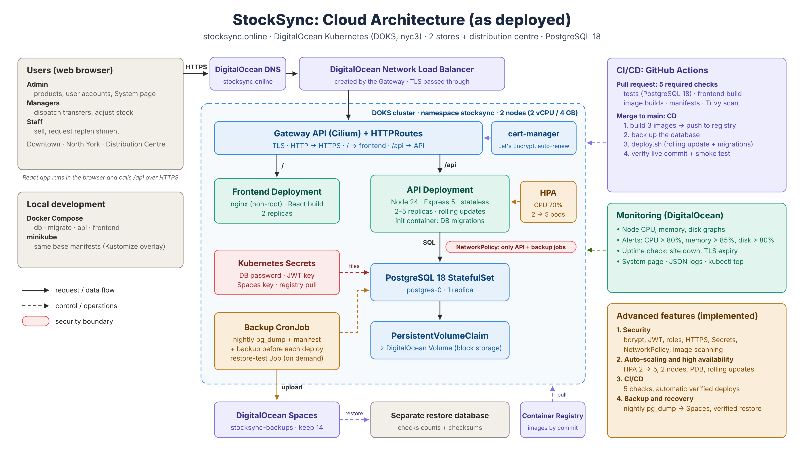
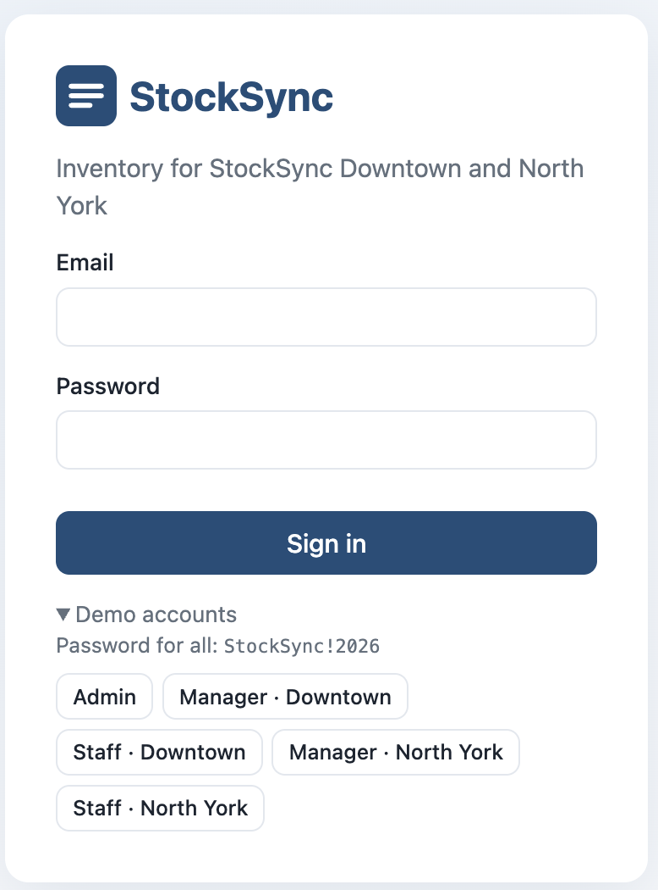
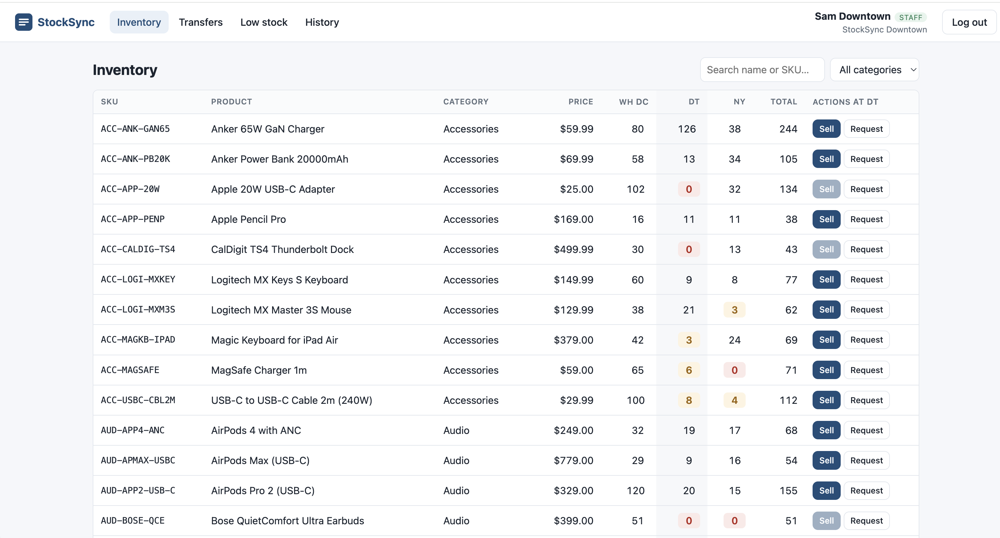
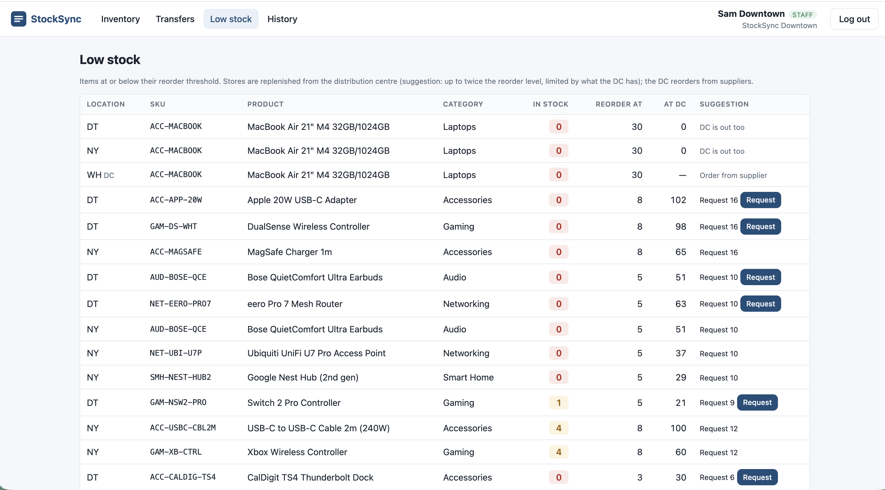
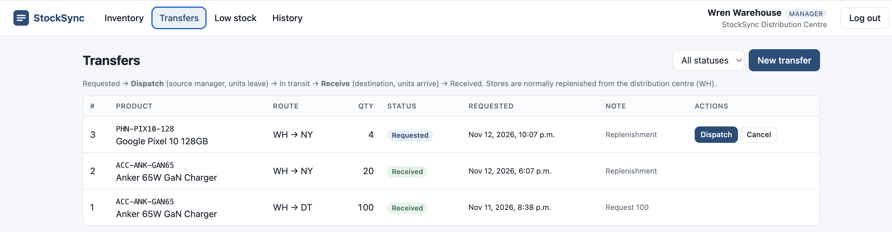
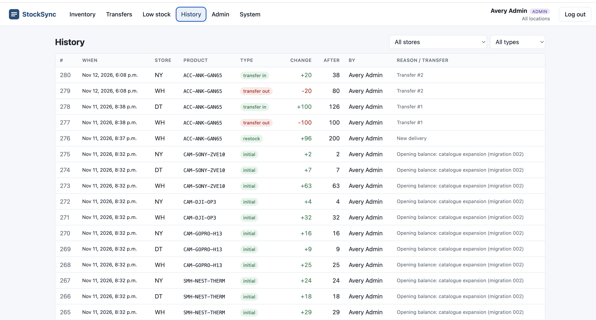
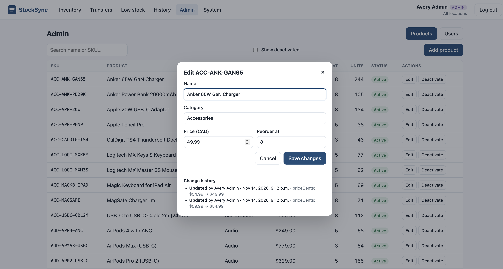
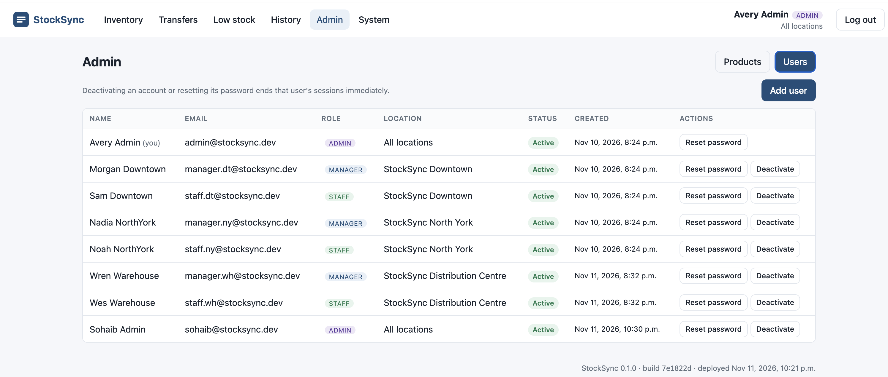
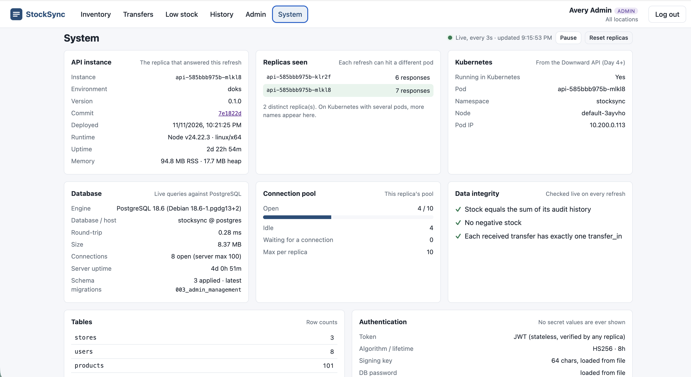

# StockSync: Smart Inventory Management for a Multi-Location Electronics Retailer

**Live application:** https://stocksync.online
**Repository:** https://github.com/sohaib629/ccproject
**Video demo:** _link to be added (see [Section 12](#12-video-demo))_


ECE1779: Introduction to Cloud Computing, Fall 2026, final project report.

---

## 1. Team Information

| Name | Student number | Email |
|---|---|---|
| Sohaib Anwar | 1013959619 | sohaib.anwar@utoronto.ca |
| Rayyan Zaman | 1007647986 | rayyan.zaman@mail.utoronto.ca |
| Yiheyis Debru Ameha | 1010796925 | yiheyis.ameha@mail.utoronto.ca |

---

## 2. Motivation

Small electronics retailers with more than one location often track inventory in
spreadsheets, group chats or disconnected records. Staff cannot tell whether an
item is really available at their store, already sold, or on its way from another
location. This is especially costly for high-value, theft-prone products such as
laptops, phones and game consoles.

StockSync targets three concrete problems:

- **Overselling.** Two staff members sell the last unit at the same moment and both
  sales succeed, because each read "1 in stock" before the other wrote.
- **Untracked transfers.** Stock leaves one location but is never confirmed at the
  other, so units disappear in between.
- **No accountability.** Quantities change without a record of who changed them,
  when, and why.

Spreadsheets are cheap but cannot coordinate concurrent changes, while full retail
suites are more than a small operator needs. A shared system with transactional
stock updates and an append-only audit history removes these discrepancies.

It is also a meaningful cloud-computing problem: inventory is **persistent state
accessed concurrently by many users through many API replicas**, which makes it a
focused setting for orchestration, persistent storage, scaling, security and
recovery.

---

## 3. Objectives

A web application for one fictional retailer with **two stores** (Downtown and North
York, Toronto) and a **distribution centre** that supplies them, deployed as a
stateful cloud-native system.

**Functional objectives**

1. Three roles (**Administrator, Manager, Staff**) with every permission enforced on
   the server, and administration of products and user accounts.
2. Per-location stock that **can never become negative**, even under concurrent sales.
3. Traceable stock flow: **supplier → distribution centre → store → sale**. New units
   enter only at the distribution centre; stores are replenished by transfer.
4. Transfers through **Requested → In Transit → Received**, received exactly once,
   with cancellation that returns in-transit units.
5. An **append-only audit history** of every stock change and every admin change.
6. A low-stock view with **rule-based replenishment suggestions**.

**Cloud objectives**

1. A reproducible local environment with Docker Compose.
2. The same application on Kubernetes, locally on minikube and in the cloud on
   DigitalOcean Kubernetes (DOKS), from one set of base manifests.
3. Self-managed PostgreSQL with persistent storage (StatefulSet + PVC on
   DigitalOcean Volumes) and versioned schema migrations.
4. HTTPS on a real domain, provider monitoring with alerts, and four advanced
   features: **security, auto-scaling and high availability, CI/CD, backup and
   recovery**.
5. Correctness that holds **no matter which API replica handles a request**, proven
   by tests rather than assumed.

Suppliers, purchasing, payments and point-of-sale integration are out of scope; the
catalogue (100 products) and stock are synthetic.

---

## 4. Technical Stack

| Layer | Technology | Why |
|---|---|---|
| Frontend | **React 19** + Vite 8, served by `nginx-unprivileged` (non-root) | Simple SPA; calls the relative path `/api`, so one build works everywhere |
| Backend | **Node.js 24, Express 5**, `pg` (raw SQL), zod, bcryptjs, jsonwebtoken, helmet, express-rate-limit, pino | Stateless REST API; raw SQL keeps transaction behaviour explicit |
| Database | **PostgreSQL 18** + numbered migrations | Constraints, triggers, row locks and transactions provide the guarantees |
| Containers | **Docker**, multi-stage images for `linux/amd64` | Same images on a Mac (M3) and in the cloud |
| Local orchestration | **Docker Compose** with secrets, healthchecks, a named volume and a migration service | One command starts the full stack |
| Kubernetes | **minikube** locally, **DOKS** (1.37) in the cloud, **Kustomize** base + overlays | One set of manifests for every environment |
| Ingress / TLS | **DOKS managed Gateway API** (Cilium) + **cert-manager** + **Let's Encrypt** | Replaces the retired Ingress NGINX; certificates declared in git, renewed automatically |
| Cloud | **DigitalOcean**: DOKS, Container Registry, Volumes, Spaces, DNS, Monitoring | One provider for compute, storage, images, backups, DNS and alerts |
| CI/CD | **GitHub Actions**: 5 required checks, automatic deployment after merge | Every change is tested and scanned before it reaches production |
| Testing | `node:test` (**73 tests**), smoke test, concurrency race script, **k6** load test, Trivy | Tests prove correctness, not just that endpoints respond |

### Architecture



The API is **stateless**: all persistent data lives in PostgreSQL, so any replica can
serve any request and correctness comes from database transactions, not in-memory
locks.

### Data model

| Table | Purpose | Integrity rules |
|---|---|---|
| `stores` | 2 stores + 1 distribution centre | `kind` ∈ {store, warehouse}; unique code |
| `users` | accounts with role, location, active flag | non-admins need a location; `token_version` ends sessions |
| `products` | SKU, name, category, price, reorder threshold | unique SKU; deactivated, never deleted |
| `stock` | quantity per product per location | unique `(store_id, product_id)`, `CHECK (quantity >= 0)` |
| `transfers` | movements between locations | different source/destination, valid status transitions |
| `stock_movements` | audit of every quantity change | **append-only** (trigger); sales only at stores, deliveries only at the DC (trigger) |
| `admin_audit` | who changed which product or account | **append-only**; never stores passwords |
| `schema_migrations` | applied migrations with SHA-256 | each migration runs once |

---

## 5. Features

### 5.1 Core inventory features

- **Sales** (stores only): one atomic conditional update,
  `UPDATE stock SET quantity = quantity - $n WHERE … AND quantity >= $n`. If no row
  changes, the sale fails with `409 OUT_OF_STOCK`. The stock change and its audit row
  commit in **one transaction**.
- **Supplier deliveries** (distribution centre only) and **manager adjustments**
  (any location, reason required).
- **Transfers**: Request → **Dispatch** (source manager; units leave) → **Receive**
  (destination; units arrive exactly once) or **Cancel** (units return). Each step
  locks the transfer row (`SELECT … FOR UPDATE`), so concurrent clicks are serialized.
- **Location rules**: a sale at the distribution centre or a delivery at a store is
  refused by the API (`409 WRONG_LOCATION_TYPE`) **and** by a database trigger.
- **Low stock with replenishment suggestions**: for each low store row,
  `suggested = min(2 × reorder level − in stock, units at the DC)`; one click turns
  it into a transfer request.
- **Audit history**: every change (`sale`, `restock`, `adjustment`, `transfer_out`,
  `transfer_in`, `transfer_return`, `initial`) with user, location, quantity and time,
  append-only by trigger.
- **Administration**: products (create, edit, deactivate/reactivate) and user
  accounts (create, deactivate/reactivate, reset password), with a change history.
- **System page** (admin): which API replica answered, the pod and node, database
  latency, size, connections and migrations, live integrity checks, the deployed
  **commit** (linked to GitHub) and deploy time.
- **Database migrations**: numbered SQL files applied once each (checksummed, in a
  transaction, behind an advisory lock) by an init container in every API pod.

### 5.2 Advanced feature 1: Security

- **bcrypt** password hashing (cost 12); **JWT** (HS256, 8 h) with the algorithm pinned.
- **Role-based authorization and location scoping on every endpoint**; the UI only
  hides buttons, the API enforces the rules (tested with 401/403 cases).
- **Sessions end immediately**: every request re-checks the account, so deactivating
  a user or resetting a password logs them out on all replicas at once.
- **Login rate limiting**: 10 wrong passwords per 15 minutes. Only wrong credentials
  count; this rule came from a bug the load test exposed (Section 11).
- **HTTPS** with a Let's Encrypt certificate, HTTP → HTTPS redirect, helmet headers
  and a strict Content-Security-Policy.
- **Secrets never in git**: Docker secrets locally, Kubernetes Secrets mounted as
  files in the cluster; each pod receives only what it needs.
- **Hardened pods**: non-root, all capabilities dropped, read-only root filesystem,
  no service-account token.
- **NetworkPolicy**: only API pods and backup jobs may connect to PostgreSQL. Shown
  live: a test pod without the API label times out; the same pod with it connects.
- **Image vulnerability scan**: Trivy scans all three images on every pull request
  and blocks merging on fixable CRITICAL issues. Its first run caught **two real
  CRITICAL CVEs** in third-party base images (Section 11).

### 5.3 Advanced feature 2: Auto-scaling and high availability

- **Two replicas** of the API and frontend, spread across both nodes, with a
  PodDisruptionBudget and zero-downtime rolling updates (`maxUnavailable: 0`).
- **Readiness vs liveness probes**: if PostgreSQL is down, API pods stop receiving
  traffic but are not restarted in a loop.
- **Horizontal Pod Autoscaler**: API **2 → 5 replicas** at 70% CPU (of a 100m
  request), adding up to 2 pods per 30 s and removing 1 per minute after 2 minutes.
- **Evidence**: k6 sustained load (≈130 requests/s for 7 minutes) scaled the API
  **2 → 4 → 5** within about a minute and back to 2 afterwards (`kubectl describe hpa`
  events). The final run passed both thresholds: **p95 676 ms, 0.08% errors**.
  Earlier runs found two bugs and a capacity limit (Section 11).

### 5.4 Advanced feature 3: CI/CD

- **CI** on every pull request, five **required** checks with branch protection
  (no direct pushes to `main`): backend tests against PostgreSQL 18, frontend build,
  Docker image builds, Kubernetes manifest validation (kubeconform, including CRDs),
  and the Trivy image scan.
- **CD** after every merge, once CI passes on `main`:
  build 3 images → push to DigitalOcean Container Registry tagged with the commit →
  **back up the database** → `k8s/deploy.sh` (rolling update; new pods migrate first)
  → **verify the live site reports the deployed commit** → smoke test.
- **Evidence**: PRs #7–#10 were deployed automatically. A watch loop of requests every
  200 ms recorded **zero failed requests** during a rolling update. Rollback by tag
  (redeploy an earlier commit without rebuilding) is built into the workflow.

### 5.5 Advanced feature 4: Backup and recovery

- **Nightly CronJob** (03:00 Toronto): `pg_dump` → DigitalOcean **Spaces**, plus a
  manifest of row counts and checksums; newest 14 kept; credentials limited to one
  bucket. CD also takes a backup **before every deploy**.
- **Restore test** (on demand): restores the newest backup into a **separate
  database**, compares counts and checksums with the manifest, runs the integrity
  checks, then drops the copy. The live database is only read.
- **Evidence**: **14/14 checks passed**. The backup CD took 23 seconds before the
  catalogue migration restored to the exact pre-migration state (2 stores, 12
  products): a proven rollback point. A deliberately corrupted backup fails the test.

### 5.6 Monitoring and observability

- **DigitalOcean provider metrics**: CPU, memory, disk and bandwidth per node (node
  **Graphs** and the cluster **Insights** tab).
- **DigitalOcean alerts**: CPU > 80%, memory > 85%, disk > 80% for 5 minutes on every
  node (by cluster tag), and an **uptime check** of `/api/health` from three regions
  that alerts when the site is down or the TLS certificate expires within 14 days
  (`monitoring/setup-alerts.sh`).
- **Application level**: the System page, structured JSON logs (pino), `kubectl top`,
  and HPA metrics.

---

## 6. User Guide

Open **https://stocksync.online** and sign in with a demo account. The demo
password and one-click sign-in buttons are shown on the login page.

| Role | Email address | Location |
|---|---|---|
| Admin | admin@stocksync.dev | All locations |
| Manager | manager.dt@stocksync.dev | Downtown Toronto |
| Staff | staff.dt@stocksync.dev | Downtown Toronto |
| Manager | manager.ny@stocksync.dev | North York |
| Staff | staff.ny@stocksync.dev | North York |
| Manager | manager.wh@stocksync.dev | Distribution Centre |
| Staff | staff.wh@stocksync.dev | Distribution Centre |



**Inventory.** All 100 products with their quantity at the distribution centre (WH)
and both stores; low and out-of-stock values are highlighted. Search, filter by
category, and page through 25 at a time. Store users can **Sell** and **Request**
units from the distribution centre; distribution-centre users **Receive delivery**
from suppliers; managers can **Adjust** with a reason.



**Low stock.** Items at or below their reorder level, with a suggested replenishment
quantity; **Request** creates the transfer.



**Transfers.** Request → **Dispatch** (source manager) → **Receive** (destination),
or **Cancel**.



**History.** The audit log, filterable by product, type and user. Managers and staff
see their own location; the administrator sees all.



**Admin** (administrator only). *Products*: add, edit (with change history),
deactivate/reactivate. *Users*: add, deactivate/reactivate, reset password.




**System** (administrator only). Live infrastructure and data-integrity status; the
footer of every page shows the running build.



**What each role can do**

| Action | Staff | Manager | Admin |
|---|---|---|---|
| View inventory, low stock | ✓ | ✓ | ✓ |
| Sell (stores only) | own store | own store | any store |
| Receive supplier delivery (DC only) | at the DC | at the DC | ✓ |
| Adjust stock | | own location | any |
| Request transfer | ✓ | ✓ | ✓ |
| Dispatch / Receive transfer | receive (destination) | dispatch (source), receive | ✓ |
| Cancel transfer | | either location's manager | ✓ |
| View history | own location | own location | all |
| Admin and System pages | | | ✓ |

---

## 7. Development Guide

### 7.1 Prerequisites
Docker Desktop, Node.js 24 (`nvm use` reads `.nvmrc`), git. For Kubernetes: `kubectl`
and minikube. For the cloud: `doctl`.

### 7.2 Run locally with Docker Compose

```bash
git clone https://github.com/sohaib629/ccproject.git && cd ccproject
openssl rand -hex 24 > secrets/db_password.txt     # git-ignored
openssl rand -hex 32 > secrets/jwt_secret.txt
cp .env.example .env                               # set WEB_HOST_PORT if 8080 is taken
docker compose up --build -d
docker compose ps        # db, api, frontend healthy; migrate "exited (0)"
open http://localhost:8080
```

The schema and seed in `database/init/` load on the first start into the named
volume; the `migrate` service then applies `backend/migrations/` (also on every
later start, idempotently). `docker compose down` stops everything and keeps the
data; `docker compose down -v` resets it.

### 7.3 Tests

| What | Command |
|---|---|
| Integration suite, 73 tests, isolated `stocksync_test` database | `cd backend && npm ci && npm test` |
| Smoke test (13 checks) | `./tests/smoke-day1.sh` |
| Last-unit race (20 buyers, 1 unit) | `node tests/concurrency-test.mjs` |
| Load test for the HPA | `BASE_URL=… DEMO_PASSWORD=… k6 run tests/load/hpa-load.js` |
| Integrity checks | `docker compose exec -T db psql -U stocksync -d stocksync < database/checks.sql` |

The smoke and race scripts accept `API_URL=…`. The test harness refuses any database
whose name does not end in `_test`. Details: [docs/testing.md](docs/testing.md).

### 7.4 Kubernetes on minikube

```bash
minikube start -p stocksync --driver=docker --cpus=4 --memory=6g
minikube -p stocksync addons enable metrics-server
docker compose build
minikube -p stocksync image load stocksync-api:dev
minikube -p stocksync image load stocksync-frontend:dev
./k8s/bootstrap.sh
kubectl apply -k k8s/overlays/minikube
kubectl -n stocksync port-forward svc/frontend 7080:8080    # http://localhost:7080
```

Design and the persistence, self-healing and rolling-update tests:
[docs/kubernetes.md](docs/kubernetes.md).

### 7.5 Repository layout

```
backend/     Express API, migrations/, Dockerfile, test suite
backup/      backup and restore-test image (pg_dump → Spaces)
database/    init/ baseline schema + seed, checks.sql
frontend/    React app and its nginx Dockerfile
k8s/         base + minikube/doks overlays, cluster issuers, bootstrap.sh, deploy.sh
monitoring/  DigitalOcean alerts and uptime check
tests/       smoke, concurrency and k6 load tests
docs/        kubernetes, deployment, operations, testing
.github/     CI and CD workflows
```

The API routes are listed with their access rules on the System page and in
`backend/src/lib/routeCatalog.js`.

---

## 8. Deployment

### 8.1 Live URL
**https://stocksync.online**: DOKS cluster `stocksync`, region `nyc3`,
Kubernetes 1.37, 2 × `s-2vcpu-4gb` nodes.

### 8.2 Cloud architecture

| Component | DigitalOcean resource |
|---|---|
| Cluster | DOKS, VPC-native (required for the managed Gateway API) |
| Images | Container Registry; tags are git commits; pulled with a registry Secret |
| Ingress / TLS | Gateway API → Network Load Balancer; cert-manager + Let's Encrypt (HTTP-01) |
| Storage | StatefulSet `postgres` with a PVC → DigitalOcean Volume |
| Backups | Spaces bucket `stocksync-backups` |
| DNS | DigitalOcean DNS for `stocksync.online` |
| Monitoring | node alerts (by cluster tag), uptime check with down and TLS alerts |

The same base manifests run on minikube and DOKS. The `doks` overlay only adds the
Gateway, routes, certificate, backup CronJobs and registry pull Secret.

### 8.3 Deployment instructions

```bash
# 1. VPC-native DOKS cluster, then: doctl kubernetes cluster kubeconfig save stocksync
# 2. cert-manager v1.21 with Gateway API support, then the issuers
kubectl apply -f k8s/cluster/cluster-issuers.yaml
# 3. Secrets (DB, JWT, Spaces key from secrets/*.txt), init SQL, registry pull secret
./k8s/bootstrap.sh doks
# 4. Build/push images, deploy pinned to the current commit (normally done by CD)
DOCR_REGISTRY=<registry> ./k8s/deploy.sh doks
# 5. Point the domain's A record at the Gateway address
kubectl -n stocksync get gateway stocksync
# 6. Monitoring
ALERT_EMAIL="$(doctl account get --format Email --no-header)" ./monitoring/setup-alerts.sh
```

CD setup, the HPA, backups and migrations: [docs/operations.md](docs/operations.md).
Design decisions and teardown: [docs/deployment.md](docs/deployment.md).

### 8.4 Verification in the cloud

| Test | Result |
|---|---|
| HTTP → HTTPS, health through the whole chain | `301`; `{"status":"ready","database":"up","commit":…}` |
| Smoke test against the live site | 13/13 (also run by every deployment) |
| Last-unit race, 20 buyers | split across both API pods; exactly 1 sale, quantity 0, 1 audit row |
| Persistence | data survives deleting `postgres-0` (DigitalOcean Volume) |
| Auto-scaling (k6) | 2 → 5 replicas and back; p95 676 ms, 0.08% errors at ≈130 req/s |
| Zero-downtime deploy | 0 failed requests during a rolling update |
| Backup and restore | 14/14; the pre-migration backup restores exactly |
| NetworkPolicy | unauthorized pod: timeout; API-labelled pod: connected |
| Image scan | 0 fixable CRITICAL CVEs in all three images |

### 8.5 Cost
About **US$4.20/day** with 2 nodes (≈$1.80 nodes, ≈$1.40 high-availability control
plane, ≈$0.50 load balancer, ≈$0.35 registry, Spaces and volume, plus tax). The
cluster stays online through grading and is deleted afterwards.

---

## 9. AI Assistance & Verification

AI tools assisted with frontend development and technical verification. Suggestions were
reviewed and checked against application behaviour and provider documentation rather
than accepted without testing.

- **Frontend verification**: We tested the Admin page, product and user actions,
  role-based access and account deactivation. Manual testing exposed a dialog layout
  issue and a session-handling bug after password resets; both were corrected.
- **Technical checks**: The project was also validated using 73 automated tests, five CI
  checks, deployment smoke tests, concurrency and load testing, restore checks, and
  monitoring evidence.
- **AI limitation identified**: An estimated cloud cost of about $65/month omitted the
  approximately $40/month DigitalOcean HA control-plane charge. We checked the actual
  billing page and provider documentation before deciding to keep the cluster running
  through grading.

The two representative interactions, their limitations and our verification steps are
documented in [ai-session.md](ai-session.md).

---

## 10. Individual Contributions

All team members contributed to the project's planning, development, testing,
deployment, documentation, and coordination.

---

## 11. Lessons Learned

### 11.1 Challenges and what the evidence showed

- **Proving correctness, not assuming it.** A deliberately naive "read, check, write"
  sale sold the last unit **8 times** to 20 concurrent buyers; the atomic version
  always sold exactly 1. A test that has never failed against broken code proves little.
- **The load test found real bugs.** The first k6 run scaled the API to 5 replicas, but
  3.5% of requests failed. (1) Probes used the default 1-second timeout, so CPU-throttled
  pods flapped out of the Service and one was restarted. (2) The rate limiter counted
  every non-2xx login, including server errors and its own 429s, and all traffic arrives
  from the load balancer's address, so a few errors locked **everyone** out. After the
  fixes (and new tests), the next run at the same load had no restarts and 0.57% errors
  but p95 3.87 s: all 5 pods were at their CPU limit, a capacity limit rather than a bug.
  At a load within capacity, both thresholds passed.
- **The image scan paid off on its first run.** It blocked the pull request on two
  CRITICAL CVEs: `brotli-libs` in the nginx base image (fixed with `apk upgrade`) and a
  `gosu` binary built with an old Go version in the PostgreSQL base image (removed; the
  backup image never uses it).
- **Secret mount collision.** Mounting our Secret at `/run/secrets` collided with the
  service-account token (`/var/run` → `/run`); disabling the token fixed it and removed
  an unneeded credential.
- **Cloud realities.** Toronto (`tor1`) had no capacity, so the cluster runs in `nyc3`.
  The first CD run failed because its image check parsed `doctl` text output; it now
  queries the registry directly. The bill was higher than estimated because DOKS 1.36+
  enables the high-availability control plane by default, and it cannot be disabled
  afterwards.

### 11.2 Key technical decisions

- **Consistency in PostgreSQL, not in the application**: conditional updates, row
  locks and transactions keep stock correct across any number of replicas, which is
  what makes horizontal scaling safe.
- **Defense in depth**: CHECK constraints and triggers (non-negative stock, append-only
  audit, location rules) hold even if application code has a bug.
- **Migrations in an init container**: a failed migration keeps the new pods from
  starting while the old ones keep serving, and CD backs up first.
- **Gateway API over Ingress NGINX** (retired), **TLS via cert-manager** (portable,
  declared in git), **images pinned to commits**, one set of manifests for every
  environment.

### 11.3 Limitations

- A **single PostgreSQL replica** is a single point of failure: the API is highly
  available, the database is not. Nightly backups could lose up to a day of changes.
- A client that times out and retries a sale could record it twice; idempotency keys
  would fix this.
- The JWT lives in `sessionStorage`; an httpOnly cookie would resist XSS better but
  needs CSRF protection. The strict CSP reduces the risk.

### 11.4 Conclusion

StockSync shows that a small application becomes a real cloud-computing problem once
its state is shared and concurrent. Orchestration and scaling are only safe when
correctness lives in the data layer, and every cloud claim (replicas, persistence,
HTTPS, recovery, security) should be backed by a test that can fail. Several of ours
did fail, and that is how the system improved.

---

## 12. Video Demo

_Link to be added: 2–5 minute demonstration._
